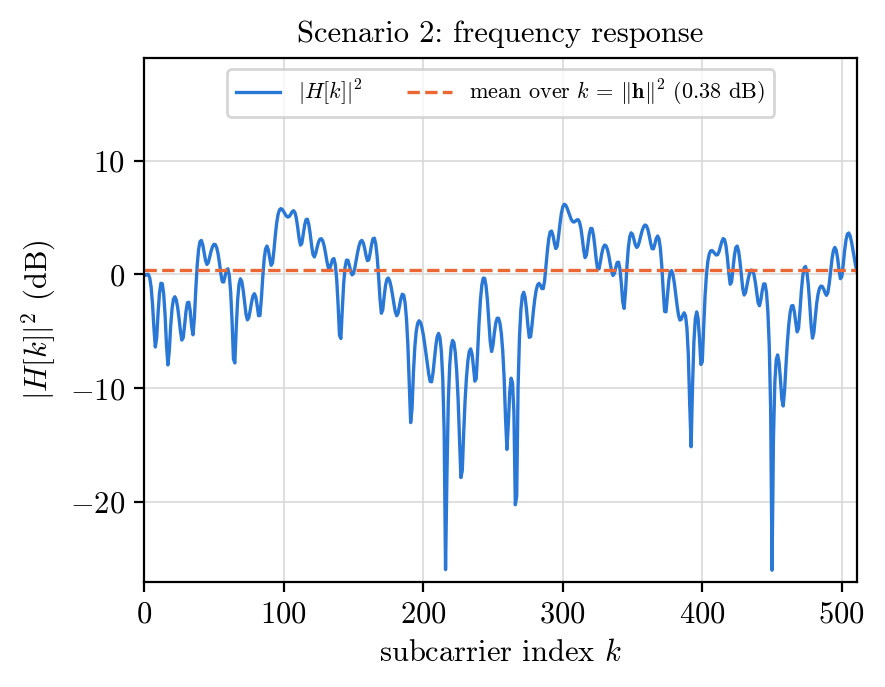
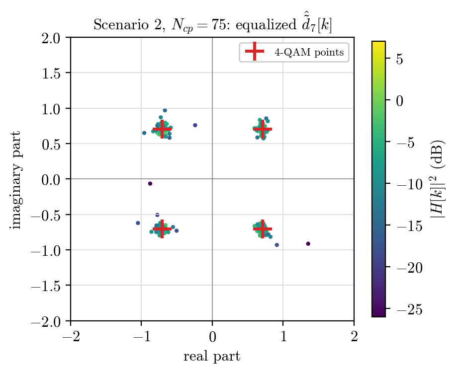
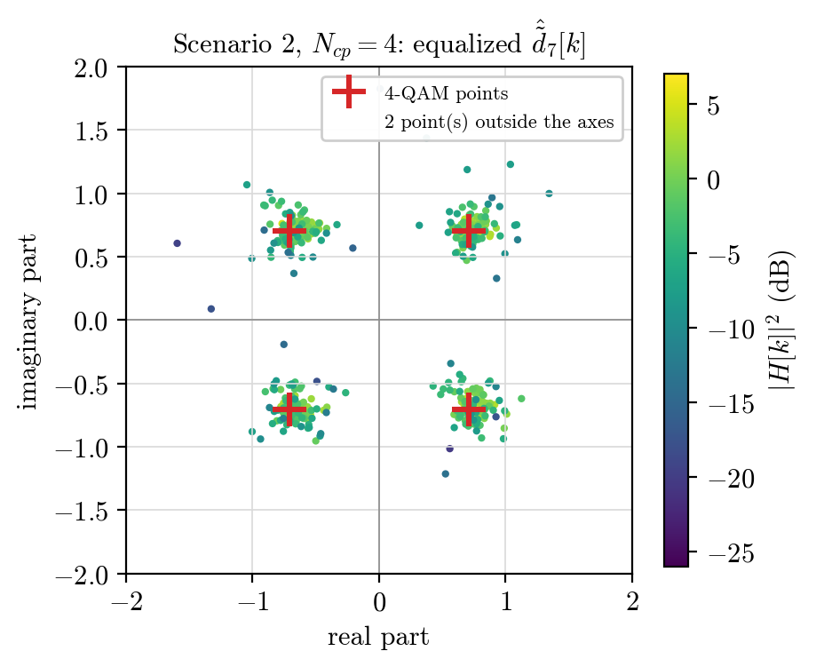

# Design of an OFDM Link for a 5G NR-like Downlink

**EC5.407 Wireless Communications — Assignment 3**<br>
Ande Karthik · 2023102009

A simplified OFDM physical layer for the downlink of a 5G NR-like system,
written from scratch in Python: transmitter, multipath channel and receiver
for one slot of 14 OFDM symbols with N = 512 subcarriers (W = 15.36 MHz,
30 kHz spacing, 4-QAM, SNR = 30 dB), over two multipath channels.

- **Report:** [Report/report.pdf](Report/report.pdf)
- **Assignment statement:** [Assignment 3.pdf](Assignment%203.pdf)

| Task | Topic | Code |
|:---:|---|---|
| 1 | CP length design | [Task-1/cp_design.py](Task-1/cp_design.py) |
| 2 | OFDM transmitter | [Task-2/transmitter.py](Task-2/transmitter.py) |
| 3 | Multipath channel | [Task-3/channel.py](Task-3/channel.py) |
| 4 | OFDM receiver | [Task-4/receiver.py](Task-4/receiver.py) |
| 5 | Results (main script) | [Task-5/main.py](Task-5/main.py), [Task-5/plots.py](Task-5/plots.py) |

## Results at a glance

<p align="center">
  
  
  
</p>

Scenario 2: frequency response (left), and the equalized symbols of OFDM symbol 7 with the
designed CP of 75 samples (middle) and with a too short CP of 4 samples (right).

## Quick start

Requires **Python 3.12** (tested with 3.12.3). Run every command from the
project root.

```bash
pip install numpy scipy matplotlib

bash run_all.sh                          # all tasks, about 25 s

cd Report && pdflatex report.tex && pdflatex report.tex     # the report
```

`run_all.sh` runs these commands, which can also be run one by one:

```bash
python3 Task-1/cp_design.py                  # Task 1: CP design
python3 Task-2/transmitter.py                # Task 2: transmitter check
python3 Task-3/channel.py                    # Task 3: channel realizations and check
python3 Task-4/receiver.py                   # Task 4: receiver check (no noise)
python3 Task-5/main.py --scenario 1          # Task 5 (a)-(c), Scenario 1, Ncp = 4
python3 Task-5/main.py --scenario 2          # Task 5 (a)-(c), Scenario 2, Ncp = 75
python3 Task-5/main.py --scenario 2 --cp 4   # Task 5 (d), Scenario 2, Ncp = 4
python3 Task-5/cp_sweep.py                   # extra: every Ncp from 0 to 80
```

The main script takes the scenario and the CP length as arguments:
`python3 Task-5/main.py --scenario S [--cp NCP]`. Without `--cp` it uses
the CP length designed in Task 1 (Ncp = L - 1).

## Random seeds

All seeds are set in [parameters.py](parameters.py). Each random block has its
own generator, `np.random.default_rng(seed)`, so the data and the channel stay
exactly the same when only the CP length changes:

| Random block | Seed |
|---|---|
| 4-QAM data symbols | **2026** |
| Channel taps, Scenario 1 | **2027** |
| Channel taps, Scenario 2 | **2028** |
| Noise | **2029** |
| Task 1 Monte Carlo check (1000 random channels) | **2030** |

Re-running the scripts reproduces every figure and number byte for byte.

## Requirements

| | Version | Used for |
|---|---|---|
| Python | 3.12.3 | everything |
| numpy | 2.3.4 | signals; `fft` and `ifft` (scaled to be unitary) and `convolve` |
| scipy | 1.16.3 | only `scipy.special.erfc`, for the Q-function |
| matplotlib | 3.10.7 | figures (Computer Modern font ships with it) |
| TeX Live | 2023 | report only: `pdflatex` with `amsmath`, `booktabs`, `caption`, `subcaption`, `enumitem`, `graphicx`, `hyperref` |

No built-in OFDM or 5G function is used.

## Reproducing each task

| Command | Reproduces | Output folder | Time |
|---|---|---|---:|
| `python3 Task-1/cp_design.py` | Task 1: CP length, overhead and SINR of shorter CPs (Tables 1–2); Fig. 1 with a Monte Carlo check over 1000 channels | `Task-1/results/` | ~11 s |
| `python3 Task-2/transmitter.py` | Task 2: check of every transmitter block (mapping, IDFT, CP, concatenation) for Ncp = 4 and 75 | `Task-2/results/` | <1 s |
| `python3 Task-3/channel.py` | Task 3: the channel realization of each scenario; checks of the taps, H[k], the convolution (against the sum formula) and the noise | `Task-3/results/` | ~1 s |
| `python3 Task-4/receiver.py` | Task 4: noise-free check of the whole link with Ncp = L - 1 and one sample less; DFT check | `Task-4/results/` | <1 s |
| `python3 Task-5/main.py --scenario 1` | Task 5 (a)-(c), Scenario 1 | `Task-5/results/scenario1_cp4/` | ~3 s |
| `python3 Task-5/main.py --scenario 2` | Task 5 (a)-(c), Scenario 2 | `Task-5/results/scenario2_cp75/` | ~3 s |
| `python3 Task-5/main.py --scenario 2 --cp 4` | Task 5 (d) | `Task-5/results/scenario2_cp4/` | ~3 s |
| `python3 Task-5/cp_sweep.py` | extra: the link for every Ncp from 0 to 80, and a check of the ISI + ICI formula | `Task-5/results/cp_sweep/` | ~2 s |

Each run of `main.py` writes six figures as `.pdf` (used in the report) and
`.png`, and a `summary.txt` with every number quoted in the report:

| Figure | Task 5 part |
|---|---|
| `channel_taps` | (a) \|h[l]\| against the tap index |
| `frequency_response` | (a) \|H[k]\|² in dB against the subcarrier index |
| `transmitted_signal` | (b) \|x[m]\| of the whole slot; below it, a zoom on OFDM symbol 0 that shows the CP is a copy of its last Ncp samples |
| `received_symbols` | (c) received values ỹ₇[k], before the equalizer |
| `equalized_symbols` | (c) equalized values with the 4-QAM points |
| `equalization_error` | extra: error after the equalizer on every subcarrier, with its expected value |

Runs on the same channel use the same axes for the scatter and error plots, so
the report can show Task 5(c) (Ncp = 75) and Task 5(d) (Ncp = 4) side by side.

## Repository layout

```
.
├── README.md
├── Assignment 3.pdf             assignment statement
├── parameters.py                Table 1 (channels), Table 2 (system), random seeds
├── plot_style.py                common figure style
├── run_all.sh                   runs all tasks
├── Task-1/
│   └── cp_design.py             Task 1: CP length, ISI + ICI power and SINR of shorter CPs
├── Task-2/
│   └── transmitter.py           Task 2: data, grid mapping, IDFT, CP, concatenation
├── Task-3/
│   └── channel.py               Task 3: tap realization, H[k], convolution + noise
├── Task-4/
│   └── receiver.py              Task 4: split, remove CP, DFT, equalizer, demapping
├── Task-5/
│   ├── main.py                  Task 5: main script for one scenario and CP length
│   ├── plots.py                 the figures of Task 5
│   └── cp_sweep.py              extra: link for every Ncp from 0 to 80
│   (each Task-N/results/ folder holds the outputs of that task)
└── Report/
    ├── report.tex
    └── report.pdf
```

Each `Task-N/results/` folder holds what that task's script writes. The report
reads its figures directly from `Task-1/results/` and `Task-5/results/`, so
after `bash run_all.sh` a new `pdflatex` run picks up the new figures.

## How the code works

Every block of Fig. 2 and Fig. 3 of the assignment is a separate function:

```
s -> map_to_resource_grid -> ofdm_modulate (F^H) -> add_cyclic_prefix -> concatenate_symbols -> x
x -> multipath_channel (h * x + w) -> y
y -> split_into_blocks -> remove_cyclic_prefix -> ofdm_demodulate (F) -> equalize (/ H[k]) -> demap_resource_grid -> s^
```

- The DFT is unitary: `F^H d = sqrt(N) ifft(d)` and `F y = fft(y) / sqrt(N)`,
  and `H[k] = fft(h, N)`. With this scaling `E|x[m]|^2 = 1` and the SNR is the
  SNR per data subcarrier.
- With `Ncp >= L - 1` the receiver sees `y~_i[k] = H[k] d~_i[k] + w~_i[k]` on
  every subcarrier, so a one-tap equalizer gives back the data with noise
  variance `1 / (SNR |H[k]|^2)`.
- The symbol errors are counted after a minimum-distance 4-QAM decision (the
  detector of Assignment 2). This decision is not part of Fig. 3; it only helps
  to compare the runs.
- Running a file of Tasks 2-4 on its own checks its blocks and writes the
  result to its `results/` folder.

## Report

[Report/report.pdf](Report/report.pdf), 15 pages:

1. **Overview**: what the link is, and why OFDM and a cyclic prefix are used
2. **Task 1**: the condition Ncp ≥ L - 1, the CP design, and why not shorter or longer
3. **Tasks 2-4**: the transmitter, the channel (with its realizations) and the receiver
4. **Task 5**: (a)-(c) for each scenario, a comparison of the two, and (d) with the
   designed and the short CP side by side
5. **Summary**

## Main results

| | Scenario 1 | Scenario 2 |
|---|---|---|
| Last tap, L - 1 | 4 samples (0.26 µs) | 75 samples (4.88 µs) |
| **CP length Ncp** | **4 samples = 0.260 µs** | **75 samples = 4.883 µs** |
| **CP overhead Ncp / (N + Ncp)** | **0.78 %** | **12.78 %** |
| \|H[k]\|² of the realization | −6.3 to +1.8 dB | −26.0 to +6.2 dB |
| Symbol errors in the slot (7168 symbols) | 0 | 1 (on the deepest fade, k = 450) |

- **Task 1:** a shorter CP costs SINR. In Scenario 2 the 5G NR normal CP of 36
  samples would give 26.4 dB instead of 30 dB.
- **Task 5(c):** after the equalizer the noise on subcarrier k has variance
  1/(SNR |H[k]|²), so the points of strong subcarriers form tight clusters and
  the points of faded subcarriers are spread far from the 4-QAM points.
- **Task 5(d):** with Ncp = 4 on the Scenario 2 channel, the taps 5 to 75 reach
  into the previous OFDM symbol. The ISI and ICI add a power of 1.3·10⁻² per
  subcarrier, 13 times the noise. The mean SINR drops from 30.4 dB to 18.8 dB
  and the symbol errors rise from 1 to 39.
