# Design of an OFDM Link for a 5G NR-like Downlink

**EC5.407 Wireless Communications - Assignment 3**<br>
Ande Karthik · 2023102009

A simplified OFDM physical layer for the downlink of a 5G NR-like system,
written from scratch in Python: transmitter, multipath channel and receiver
for one slot of 14 OFDM symbols with N = 512 subcarriers (W = 15.36 MHz,
30 kHz spacing, 4-QAM, SNR = 30 dB), over two multipath channels.

- **Report:** [Report/report.pdf](Report/report.pdf)
- **Assignment statement:** [Assignment 3.pdf](Assignment%203.pdf)

## What the assignment asks for in the README

| Required | Where |
|---|---|
| Programming language and version | [Requirements](#requirements): Python 3.12.3 |
| Required packages | [Requirements](#requirements): numpy, scipy, matplotlib |
| Commands to reproduce the results | [How to run](#how-to-run) |
| Random seed | [Random seeds](#random-seeds): 2026 (data), 2027 / 2028 (channels), 2029 (noise) |

The other code requirements are also met: each block of Figs. 2 and 3 of the
assignment is a separate function, and [Task-5/main.py](Task-5/main.py) is a main
script that makes all figures for a given scenario and CP length.

## Requirements

| | Version | Used for |
|---|---|---|
| **Python** | **3.12.3** | everything |
| numpy | 2.3.4 | signals; `fft` and `ifft` (scaled to be unitary) and `convolve` |
| scipy | 1.16.3 | only `scipy.special.erfc`, for the Q-function |
| matplotlib | 3.10.7 | figures (the Computer Modern font ships with it) |
| TeX Live (pdfTeX) | 2023 | only to rebuild the report: `amsmath`, `booktabs`, `caption`, `subcaption`, `enumitem`, `graphicx`, `hyperref` |

Install the Python packages with:

```bash
pip install numpy scipy matplotlib
```

No built-in OFDM or 5G function is used.

## How to run

Run every command from the project root.

**Everything at once**, then the report:

```bash
bash run_all.sh
cd Report && pdflatex report.tex && pdflatex report.tex
```

**The main script** makes all figures of Task 5 for one scenario and CP length:

```bash
python3 Task-5/main.py --scenario S [--cp NCP]
```

`S` is 1 or 2. Without `--cp` it uses the CP length designed in Task 1
(Ncp = L - 1). The output goes to `Task-5/results/scenario<S>_cp<NCP>/`.

**Each task on its own** (these are the commands in `run_all.sh`):

| Command | Reproduces | Output |
|---|---|---|
| `python3 Task-1/cp_design.py` | Task 1: CP length, overhead, SINR of shorter CPs, Monte Carlo check, Fig. 1 of the report | `Task-1/results/` |
| `python3 Task-2/transmitter.py` | Task 2: check of every transmitter block, for Ncp = 4 and 75 | `Task-2/results/` |
| `python3 Task-3/channel.py` | Task 3: the channel realization of each scenario and its checks | `Task-3/results/` |
| `python3 Task-4/receiver.py` | Task 4: noise-free check of the whole link | `Task-4/results/` |
| `python3 Task-5/main.py --scenario 1` | Task 5 (a)-(c), Scenario 1, Ncp = 4 | `Task-5/results/scenario1_cp4/` |
| `python3 Task-5/main.py --scenario 2` | Task 5 (a)-(c), Scenario 2, Ncp = 75 | `Task-5/results/scenario2_cp75/` |
| `python3 Task-5/main.py --scenario 2 --cp 4` | Task 5 (d), Scenario 2, Ncp = 4 | `Task-5/results/scenario2_cp4/` |
| `python3 Task-5/cp_sweep.py` | extra: the link for every Ncp from 0 to 80 | `Task-5/results/cp_sweep/` |

Each run of `main.py` writes seven figures, as `.pdf` (used in the report) and
`.png`, and a `summary.txt` with every number of that run:

| Figure | Task 5 part |
|---|---|
| `channel_taps` | (a) \|h[l]\| against the tap index |
| `frequency_response` | (a) \|H[k]\|² in dB against the subcarrier index |
| `transmitted_signal` | (b) \|x[m]\| against the sample index for the whole slot (top), and a zoom on OFDM symbol 0 that shows the CP is a copy of its last Ncp samples (bottom) |
| `amplitude_histogram` | (b) histogram of the amplitudes \|x[m]\| with the Rayleigh density, mean amplitude and PAPR |
| `received_symbols` | (c) received values ỹ₇[k], before the equalizer |
| `equalized_symbols` | (c) equalized values and the 4-QAM points |
| `equalization_error` | extra: error after the equalizer on every subcarrier, with its expected value |

Runs on the same channel use the same axes, so Task 5(c) and 5(d) can be
compared side by side.

## Random seeds

All seeds are set in [parameters.py](parameters.py). Each random block has its
own generator, `np.random.default_rng(seed)`, so the data and the channel stay
exactly the same when only the CP length changes:

| Random block | Seed |
|---|---|
| 4-QAM data symbols | **2026** |
| Channel taps, Scenario 1 | **2027** |
| Channel taps, Scenario 2 | **2028** |
| Noise | **2029** |
| Task 1 Monte Carlo check (1000 random channels) | **2030** |

Re-running the scripts reproduces every figure and number exactly.

## Results

All numbers below are read from the `results/` folders.

### Task 1: CP length

Ncp = L - 1, the delay of the last channel tap: the shortest CP with no ISI
and no ICI. The same Ncp is used for all 14 OFDM symbols of a slot. The CP must
cover the maximum delay, not the rms delay spread: in Scenario 2 it is 6.5 times
τ_rms, where τ_rms² = Σ σ²ₗ l² − (Σ σ²ₗ l)².

| | Scenario 1 | Scenario 2 |
|---|---|---|
| Last non-zero tap, L - 1 | 4 samples | 75 samples |
| rms delay spread | 68 ns | 747 ns |
| Coherence bandwidth | 2.93 MHz ≈ 98 subcarriers | 0.27 MHz ≈ 9 subcarriers |
| **CP length Ncp (samples)** | **4** | **75** |
| **CP length Ncp / W (µs)** | **0.260** | **4.883** |
| **CP overhead Ncp / (N + Ncp)** | **0.78 %** | **12.78 %** |
| Slot length M = 14 (N + Ncp) | 7224 samples | 8218 samples |

A shorter CP costs SINR (average over the channel, SNR = 30 dB):

| Scenario | Ncp | Overhead | ISI + ICI | SINR | SINR loss |
|---|---:|---:|---:|---:|---:|
| 1 | 3 | 0.58 % | −36.8 dB | 29.2 dB | 0.8 dB |
| 1 | **4 (chosen)** | 0.78 % | 0 | **30.0 dB** | 0 |
| 2 | 36 (5G NR normal CP) | 6.57 % | −28.9 dB | 26.4 dB | 3.6 dB |
| 2 | 55 | 9.70 % | −35.1 dB | 28.8 dB | 1.2 dB |
| 2 | **75 (chosen)** | 12.78 % | 0 | **30.0 dB** | 0 |

A simulation of the link over 1000 random channels agrees with the formula
within 2.6 % (SINR within 0.1 dB).

<p align="center">
  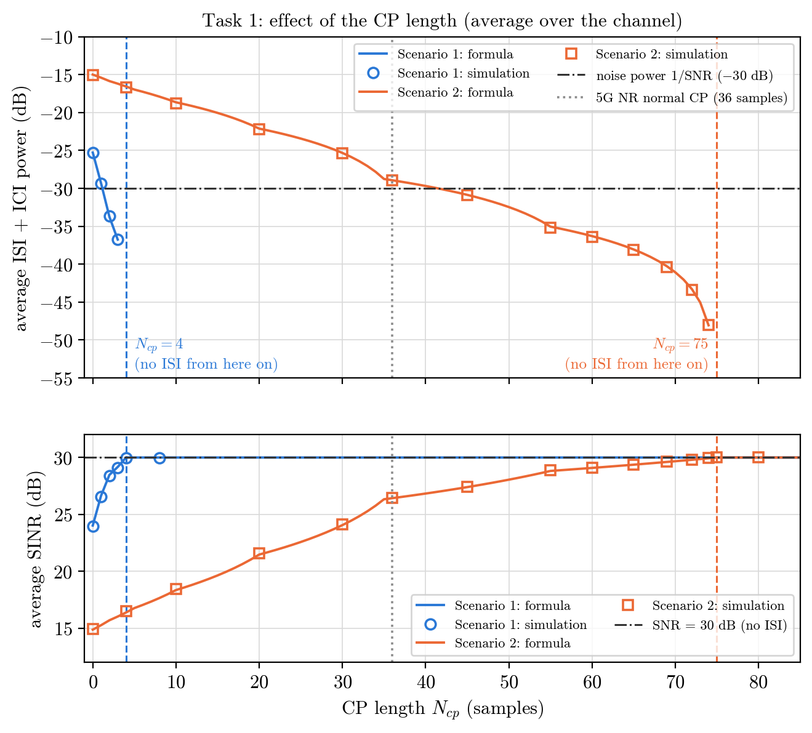
</p>

### Task 2: transmitter

[Task-2/results/transmitter_check.txt](Task-2/results/transmitter_check.txt), for Ncp = 4 and 75:

- 7168 4-QAM symbols with average energy E|s|² = 1.000000.
- Grid mapping: d̃ᵢ[k] = s[Ni + k] at every position.
- IDFT: √N · ifft equals the matrix product F^H d̃ within 2.8·10⁻¹³; every dᵢ has energy N = 512.
- The CP equals the last Ncp samples exactly, and every block of x is in the right order.
- Length of x: M = 7224 (Ncp = 4) and 8218 (Ncp = 75); average power 1.0000 and 0.9946.

### Task 3: channel

[Task-3/results/channel_check.txt](Task-3/results/channel_check.txt). One realization per scenario:

| Scenario 1 tap l | σ²ₗ | h[l] | \|h[l]\|² |
|---:|---:|---|---:|
| 0 | 0.539 | +0.0576 − 0.0435j | 0.0052 |
| 1 | 0.271 | −0.2960 − 0.7922j | 0.7152 |
| 2 | 0.136 | +0.3160 − 0.1257j | 0.1157 |
| 4 | 0.054 | −0.0320 − 0.1451j | 0.0221 |
| | | **‖h‖²** | **0.8582** |

| Scenario 2 tap l | σ²ₗ | h[l] | \|h[l]\|² |
|---:|---:|---|---:|
| 0 | 0.277 | −0.0892 + 0.4362j | 0.1983 |
| 2 | 0.219 | −0.4915 − 0.5895j | 0.5890 |
| 5 | 0.174 | −0.2786 + 0.1270j | 0.0937 |
| 10 | 0.138 | −0.1501 + 0.3471j | 0.1430 |
| 20 | 0.110 | +0.0394 + 0.1479j | 0.0234 |
| 35 | 0.069 | +0.0279 + 0.0766j | 0.0066 |
| 55 | 0.009 | +0.0243 − 0.1852j | 0.0349 |
| 75 | 0.004 | +0.0070 + 0.0417j | 0.0018 |
| | | **‖h‖²** | **1.0908** |

Checks: `fft(h, N)` equals the sum formula of H[k] (error ≤ 1.2·10⁻¹⁴);
`convolve(x, h)` equals y[m] = Σ h[l] x[m − l] (error 7·10⁻¹⁶) and has
M + L − 1 samples; the average of |h[l]|² over 20 000 draws is close to σ²ₗ;
the measured noise variance × SNR is 0.996.

### Task 4: receiver

[Task-4/results/receiver_check.txt](Task-4/results/receiver_check.txt). One slot through the whole link without noise:

| | Ncp | max \|ỹ − H d̃\| | max \|ŝ − s\| |
|---|---:|---:|---:|
| Scenario 1 | 4 = L − 1 | 1.0·10⁻¹⁵ | 1.4·10⁻¹⁵ |
| Scenario 1 | 3 | 1.2·10⁻² | 2.5·10⁻² |
| Scenario 2 | 75 = L − 1 | 1.4·10⁻¹⁵ | 6.7·10⁻¹⁵ |
| Scenario 2 | 74 | 5.0·10⁻³ | 1.0·10⁻¹ |

With Ncp = L − 1 the receiver gets the data back exactly; with one sample
less it does not. The DFT `fft / √N` equals F y within 4.8·10⁻¹³.

### Task 5: results

From the `summary.txt` file of each run. Averages use the OFDM symbols 1–13, because
with a too short CP symbol 0 has nothing before it and gets only half of the
interference (measured: 0.51).

| | Scenario 1, Ncp = 4 | Scenario 2, Ncp = 75 | Scenario 2, Ncp = 4 (5d) |
|---|---|---|---|
| **(a)** ‖h‖² | 0.858 | 1.091 | 1.091 |
| \|H[k]\|² min | −6.3 dB (k = 416) | −26.0 dB (k = 450) | same channel |
| \|H[k]\|² max | +1.8 dB (k = 172) | +6.2 dB (k = 301) | same channel |
| Subcarriers with \|H[k]\|² < −10 dB | 0 | 27 | 27 |
| **(b)** mean \|x[m]\|² | 1.0000 | 0.9946 | 1.0000 |
| mean \|x[m]\| (Rayleigh: 0.886) | 0.885 | 0.883 | 0.885 |
| PAPR | 9.55 dB | 9.57 dB | 9.55 dB |
| **(c)** power of ỹ − H d̃ (noise: 1.000·10⁻³) | 1.010·10⁻³ | 1.013·10⁻³ | 1.275·10⁻² |
| ISI + ICI power | 0 | 0 | 1.344·10⁻² |
| Mean SINR | 29.3 dB | 30.4 dB | 18.8 dB |
| SINR per subcarrier | 23.7 to 31.8 dB | 4.0 to 36.2 dB | −10.3 to 25.7 dB |
| Mean error after the equalizer, measured / expected | 1.52 / 1.52 ·10⁻³ | 4.57 / 4.70 ·10⁻³ | 6.30 / 7.77 ·10⁻² |
| Symbol errors in OFDM symbol 7 | 0 | 1 | 4 |
| Symbol errors in the slot of 7168 | 0 | 1 (k = 450, deepest fade) | 39 |

- **(a)** Scenario 1 is a smooth channel; Scenario 2 changes fast and has deep fades.
- **(b)** |x[m]| looks like noise, and its amplitudes follow the Rayleigh density.
  The PAPR is about 9.6 dB, so the power amplifier must stay linear over the peaks.
  The zoom shows that the CP is a copy of the last Ncp samples of each OFDM symbol.
- **(c)** Before the equalizer the points are rotated and scaled by H[k]. After it,
  the error on subcarrier k has variance 1/(SNR |H[k]|²): tight clusters on strong
  subcarriers, wide spread on faded ones. Scenario 2's one error is on its deepest
  fade; real systems protect such subcarriers with channel coding.
- **(d)** With Ncp = 4 (much shorter than L − 1 = 75) the taps 5 to 75 reach into
  the previous OFDM symbol, which causes ISI and ICI.
  - Before the equalizer the plot looks almost the same: the interference is only
    1.2 % of the received signal power.
  - After the equalizer every cluster is wide, also on strong subcarriers. The
    interference D[k] is 13 times the noise on average (−22.8 to −15.2 dB over
    the subcarriers; a noise-free simulation of 200 slots agrees within about 2 %).
  - The mean SINR drops from 30.4 dB to 18.8 dB; even the best subcarrier only
    reaches 25.7 dB (36.2 dB with Ncp = 75).
  - The symbol errors rise from 1 to 39, on 10 subcarriers in or next to the deepest
    fades, where the SINR is −10.3 to 4.1 dB. A Gaussian-noise estimate gives about 51.
  - Tap 55 has only 3 % of the channel energy but causes 52 % of the interference;
    tap 10 is next with 25 %.
  - More transmit power cannot remove it; only a CP of at least 75 samples can.

**Scenario 1, Ncp = 4**

<p align="center">
  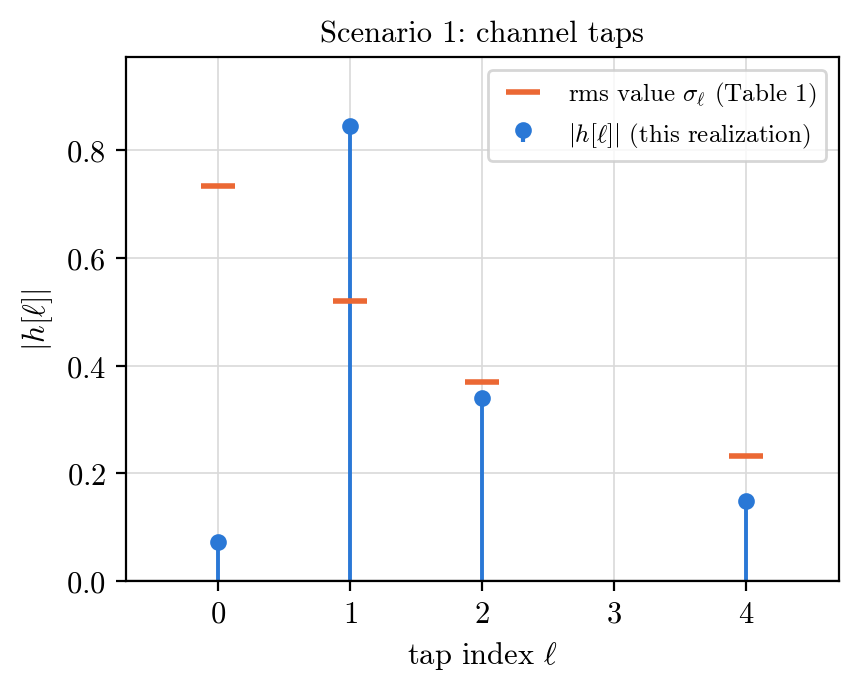
  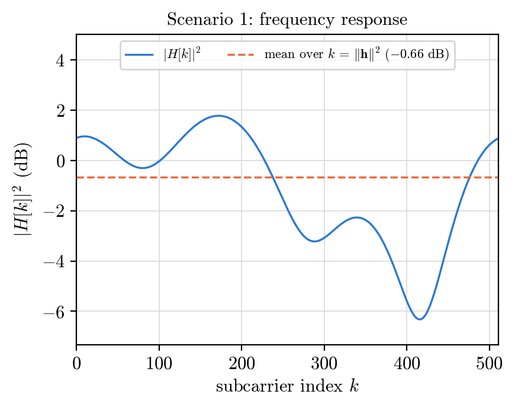
</p>
<p align="center">
  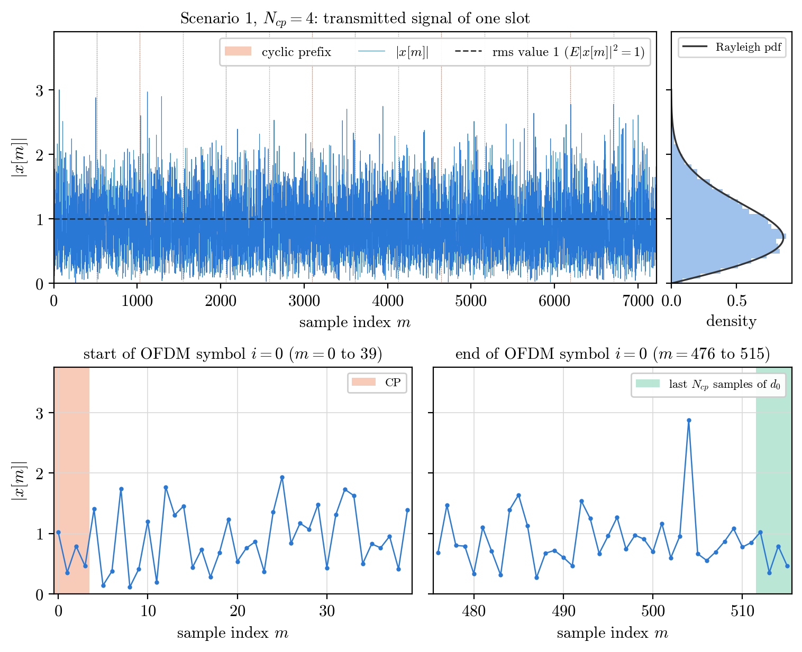
  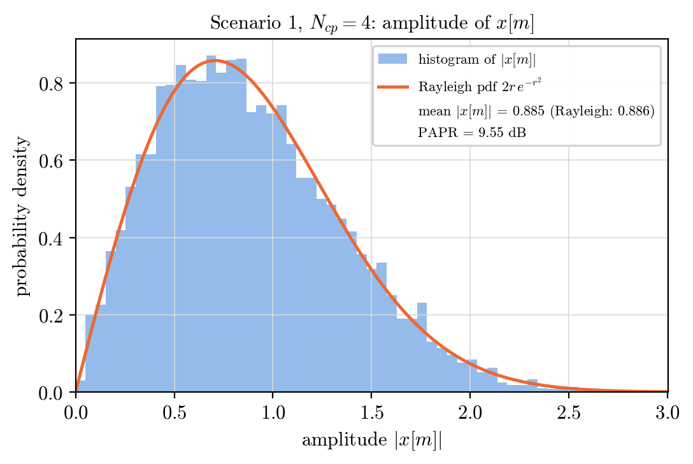
</p>
<p align="center">
  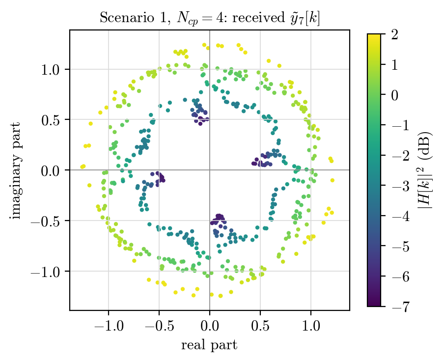
  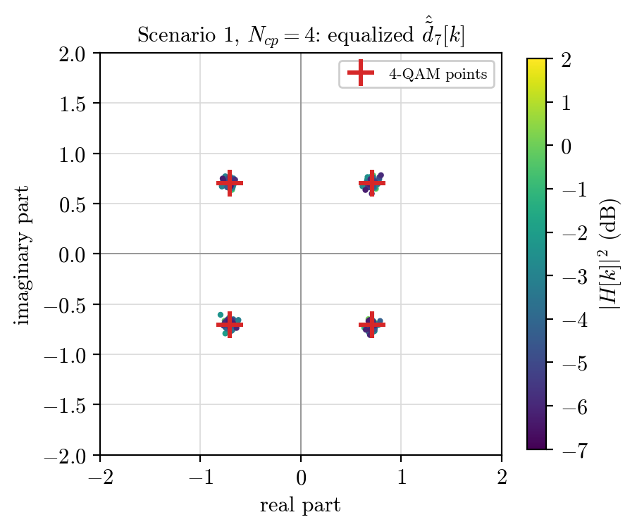
</p>

**Scenario 2, Ncp = 75**

<p align="center">
  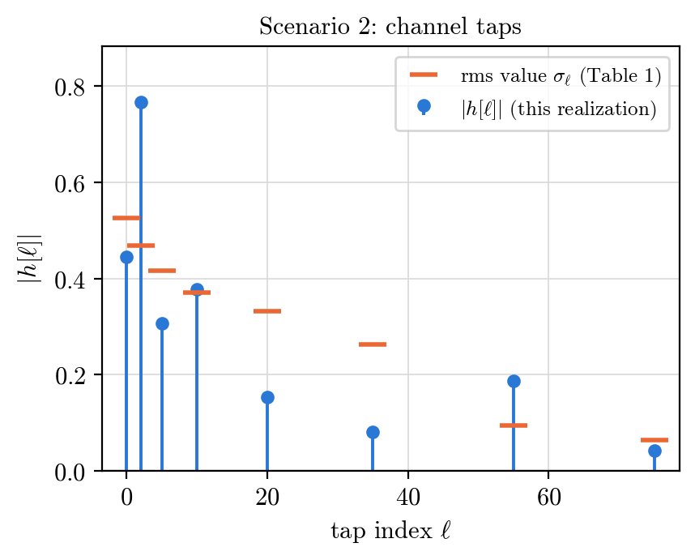
  
</p>
<p align="center">
  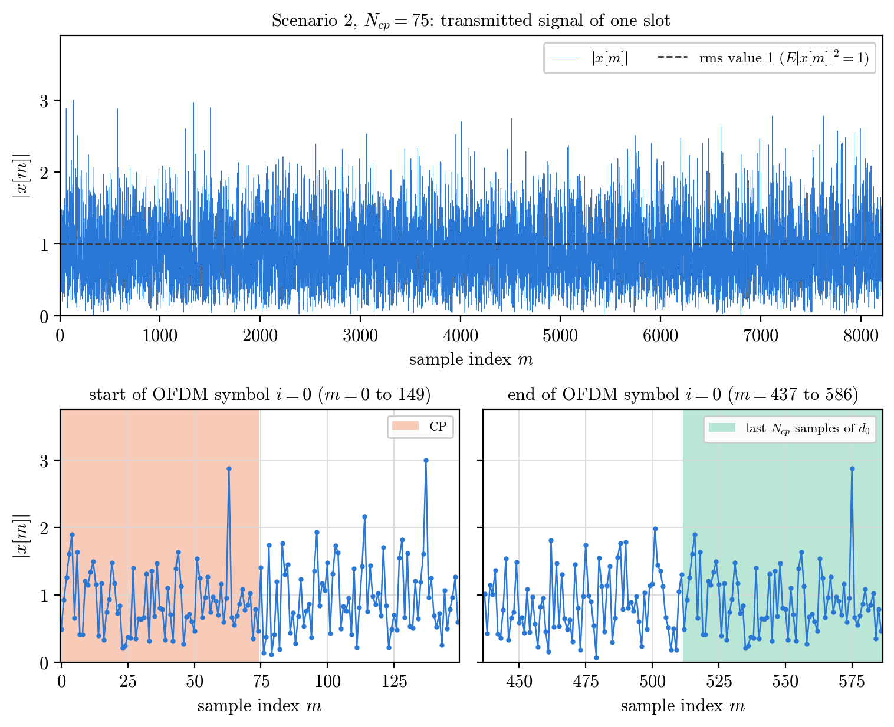
  
</p>
<p align="center">
  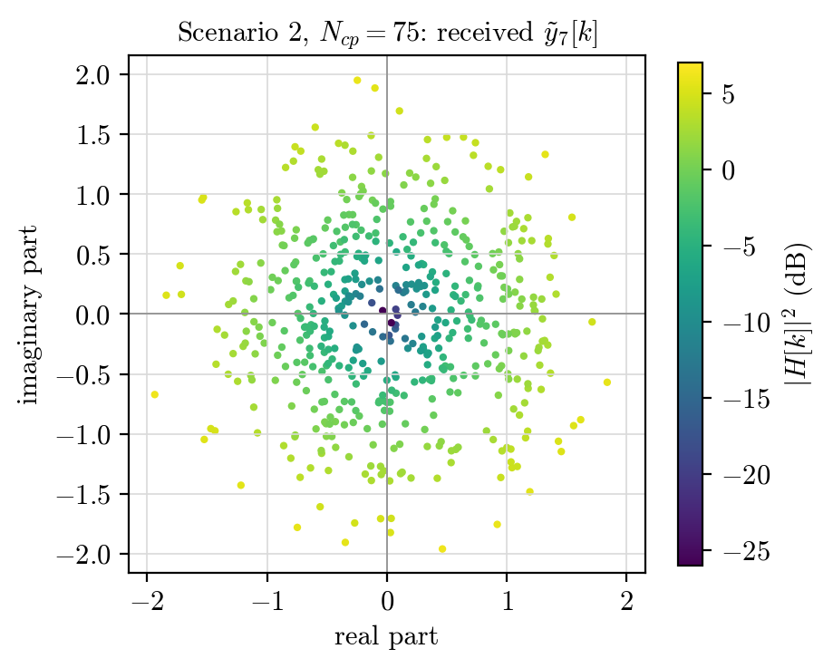
  
</p>

**Task 5(d): Scenario 2 with Ncp = 75 (left) and Ncp = 4 (right)**

<p align="center">
  
  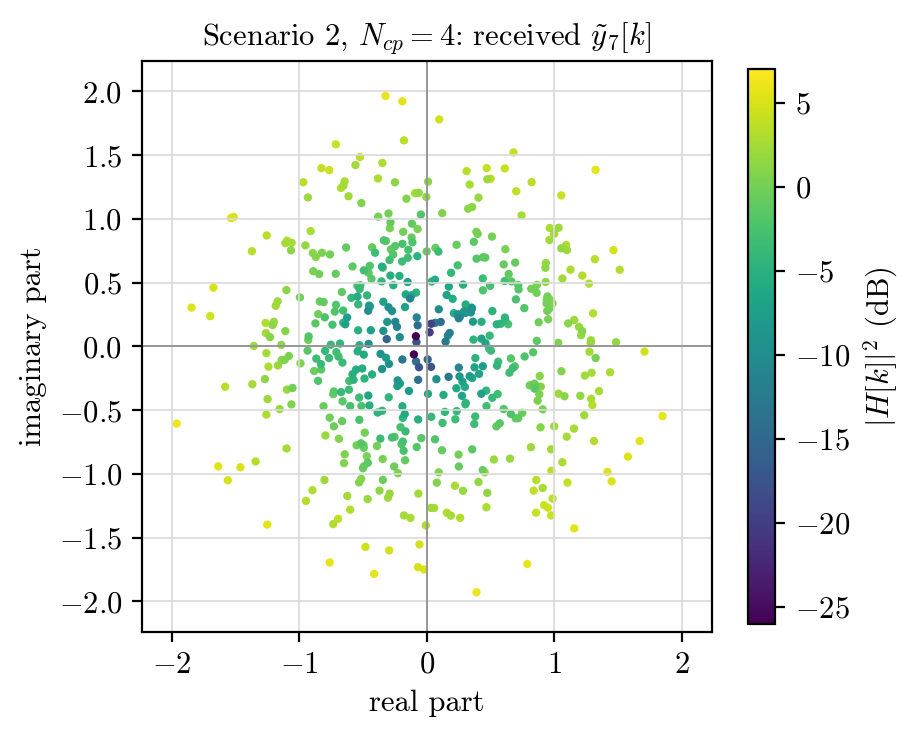
</p>
<p align="center">
  
  
</p>
<p align="center">
  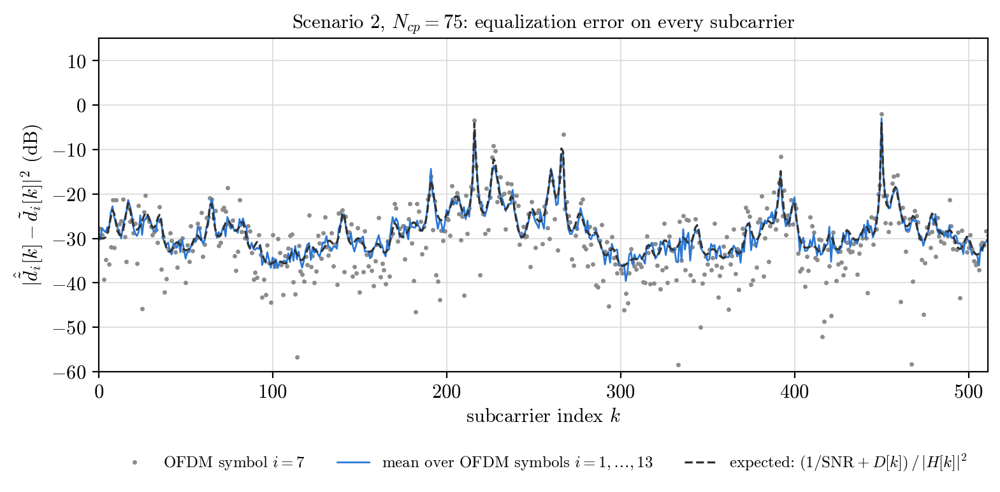
  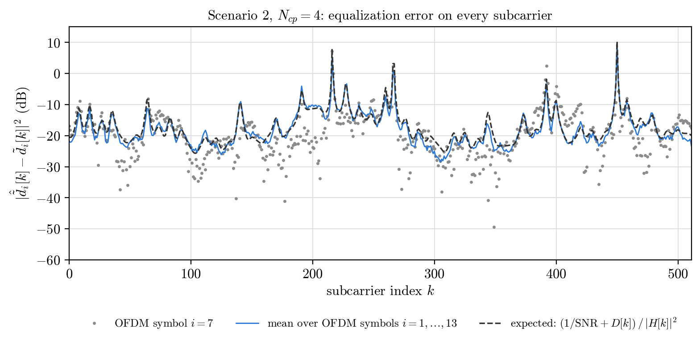
</p>

## Repository layout

```
.
├── README.md
├── Assignment 3.pdf             assignment statement
├── parameters.py                Table 1 (channels), Table 2 (system), random seeds
├── plot_style.py                common figure style
├── run_all.sh                   runs all tasks
├── Task-1/
│   └── cp_design.py             Task 1: CP length, ISI + ICI power and SINR of shorter CPs
├── Task-2/
│   └── transmitter.py           Task 2: data, grid mapping, IDFT, CP, concatenation
├── Task-3/
│   └── channel.py               Task 3: tap realization, H[k], convolution + noise
├── Task-4/
│   └── receiver.py              Task 4: split, remove CP, DFT, equalizer, demapping
├── Task-5/
│   ├── main.py                  Task 5: main script for one scenario and CP length
│   ├── plots.py                 the figures of Task 5
│   └── cp_sweep.py              extra: link for every Ncp from 0 to 80
│   (each Task-N/results/ folder holds the outputs of that task)
└── Report/
    ├── report.tex
    └── report.pdf
```

The report reads its figures directly from `Task-1/results/` and
`Task-5/results/`, so after `bash run_all.sh` a new `pdflatex` run picks up
the new figures.

## How the code works

Every block of Fig. 2 and Fig. 3 of the assignment is a separate function:

```
s -> map_to_resource_grid -> ofdm_modulate (F^H) -> add_cyclic_prefix -> concatenate_symbols -> x
x -> multipath_channel (h * x + w) -> y
y -> split_into_blocks -> remove_cyclic_prefix -> ofdm_demodulate (F) -> equalize (/ H[k]) -> demap_resource_grid -> s^
```

- The DFT is unitary: `F^H d = sqrt(N) ifft(d)` and `F y = fft(y) / sqrt(N)`,
  and `H[k] = fft(h, N)`. With this scaling `E|x[m]|^2 = 1` and the SNR is the
  SNR per data subcarrier.
- With `Ncp >= L - 1` the receiver sees `y~_i[k] = H[k] d~_i[k] + w~_i[k]` on
  every subcarrier, so a one-tap equalizer gives back the data with noise
  variance `1 / (SNR |H[k]|^2)`.
- The symbol errors are counted after a minimum-distance 4-QAM decision (the
  detector of Assignment 2). This decision is not part of Fig. 3; it only helps
  to compare the runs.
- Running a file of Tasks 2-4 on its own checks its blocks and writes the
  result to its `results/` folder.

## Report

[Report/report.pdf](Report/report.pdf), 15 pages:

1. **Overview**: what the link is, and why OFDM and a cyclic prefix are used
2. **Task 1**: the condition Ncp ≥ L - 1, the CP design, and why not shorter or longer
3. **Tasks 2-4**: the transmitter, the channel (with its realizations) and the receiver
4. **Task 5**: (a)-(c) for each scenario, a comparison of the two, and (d) with the
   designed and the short CP side by side
5. **Summary**
